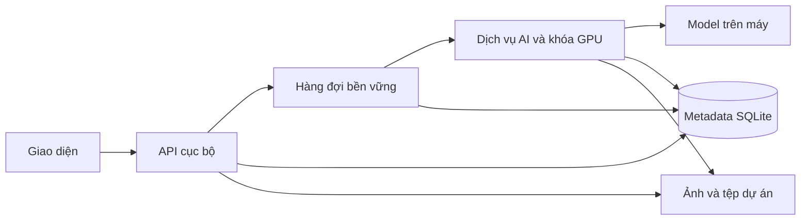

# Kiến trúc AI Atelier 3.0

Ứng dụng vẫn chạy cục bộ trên máy. Bản 3.0 chia mã theo trách nhiệm, dùng hàng đợi
bền vững cho các luồng sinh ảnh và chuyển metadata vận hành sang SQLite.

## Ranh giới mô-đun

| Khu vực | Nguồn cần sửa | Vai trò |
|---|---|---|
| Giao diện | `apps/web/core`, `apps/web/features`, `apps/web/styles` | 15 mô-đun lõi; mỗi mô-đun sở hữu trạng thái của mình. `AtelierStore` đọc trạng thái đó qua một giao diện chung. |
| API | `apps/local-api` | Ghép các dịch vụ thư viện, tác vụ, model, prompt, đánh giá và quản trị; giữ các đường dẫn API cũ. |
| AI | `services/ai` | Cấu hình, bộ nhớ model, xử lý ảnh, tác vụ, HTTP và nhật ký thực thi. `TaskContext` cung cấp phụ thuộc rõ ràng. |
| Hợp đồng | `packages/contracts` | Danh mục tác vụ, trạng thái và kiểu dữ liệu dùng chung. |
| Trình sửa ảnh | `packages/editor-core` | Quy tắc tài liệu, vùng ảnh và xuất ảnh dùng chung giữa trình duyệt và dịch vụ nền. |
| Lưu trữ | `packages/storage` | Giao dịch SQLite, chuyển đổi, bản dự phòng và xuất ngược JSON. |
| Runtime | `packages/runtime`, `scripts/runtime.ps1` | Tìm Node/Python qua biến môi trường, runtime trong thư mục ứng dụng hoặc môi trường Python sẵn có. |

`app/server.js` và `ai_service.py` là điểm khởi động tương thích. Tệp
`app/public/app.js` và các bản sao mã giao diện được tạo bằng `node scripts/build-web.js`.
Không chỉnh trực tiếp các tệp được sinh này.

## Vòng đời tác vụ

`POST /api/tasks` nhận `{kind, jobId, payload}` và trả mã tác vụ ngay khi đã lưu
yêu cầu. `GET /api/tasks/<jobId>` đọc trạng thái;
`POST /api/tasks/<jobId>/cancel` hủy tại điểm an toàn. Các API tạo ảnh cũ vẫn chờ
kết quả như trước, nhưng công việc đã được giao cho dịch vụ nền.

Mã tác vụ và dấu kiểm nội dung ngăn một yêu cầu bị gửi hai lần. Gửi lại cùng mã với
nội dung khác bị từ chối. Kết quả được ghi trước khi trả HTTP, vì vậy đóng trang hoặc
mất kết nối không làm mất kết quả đã hoàn tất. Nếu chưa xác định được AI có nhận
yêu cầu hay chưa, hàng đợi dừng để người dùng kiểm tra thay vì tự sinh ảnh trùng.

Sau khi dịch vụ AI khởi động lại, tác vụ đang chạy chuyển thành gián đoạn. Lượt sinh
ảnh đơn chạy lại yêu cầu đã lưu từ đầu; lô ảnh tiếp tục từ các mục còn thiếu.
Điểm phục hồi không phải trạng thái giữa các bước diffusion. Nhật ký ghi phiên bản
nguồn, dấu kiểm yêu cầu, dấu kiểm danh mục prompt và lịch sử prompt. Không cam kết
kết quả giống từng pixel giữa các phiên bản model hoặc runtime khác nhau.

## Dữ liệu và tương thích

SQLite quản lý tác vụ/yêu cầu/checkpoint, hàng đợi, phiên sửa và phiên bản của chúng,
vùng chọn, chỉ mục thư viện, lịch sử chỉnh sửa và bộ nghiệm thu. Ảnh gốc, ảnh kết quả,
model và tài nguyên nhị phân vẫn nằm trong hệ thống tệp. Cấu hình và prompt giữ dạng
JSON để công cụ quản trị hiện có tiếp tục sử dụng.

Chuyển đổi tạo bản dự phòng, kiểm tra JSON, ghi cơ sở dữ liệu tạm, đối chiếu từng bản
ghi và kiểm tra toàn vẹn trước khi kích hoạt. Giao dịch lưu phiên sửa bao gồm cả
phiên bản mới và đầu phiên. Node và Python cùng đọc bản dữ liệu đang có hiệu lực.
Tệp JSON cũ được giữ để đối chiếu, nhưng không phải nguồn dữ liệu đang dùng sau khi
kích hoạt SQLite.

## Kiểm thử

- `node scripts/run-tests.js --label <ten>`: chạy hồi quy trong bản sao nguồn và dữ
  liệu riêng; không nhận hàng đợi/tác vụ của người dùng.
- `node tests/modular-runtime.test.js`: chạy API thật với SQLite và AI giả lập.
- `.venv-sam2/Scripts/python.exe tests/modular-runtime.test.py`: kiểm tra phụ thuộc
  của mô-đun AI, HTTP, lưu kết quả và chống yêu cầu trùng mà không nạp model.
- `node node_modules/typescript/bin/tsc --noEmit`: kiểm tra kiểu của hợp đồng chung.

Các kiểm thử thuật toán cũ có lớp nối trong `tests/helpers`: đọc thân hàm từ nguồn
mới và đưa phụ thuộc về biến giả lập của kiểm thử. Lớp nối chỉ lưu thứ tự/tên khai
báo, không lưu bản triển khai cũ. Các kiểm thử tích hợp bổ sung kiểm tra cách ghép
mô-đun thực tế.

## Phạm vi chất lượng ảnh

Refactor bảo toàn thuật toán và luồng hoàn thiện ảnh. Kết quả nghiệm thu 2.7 được
giữ lại; ca thay áo khó vẫn có bước hoàn thiện thủ công. Kiểm thử phần mềm và các
ảnh kiểm tra kỹ thuật không thay thế đánh giá thẩm mỹ trên toàn bộ trường hợp dùng.
